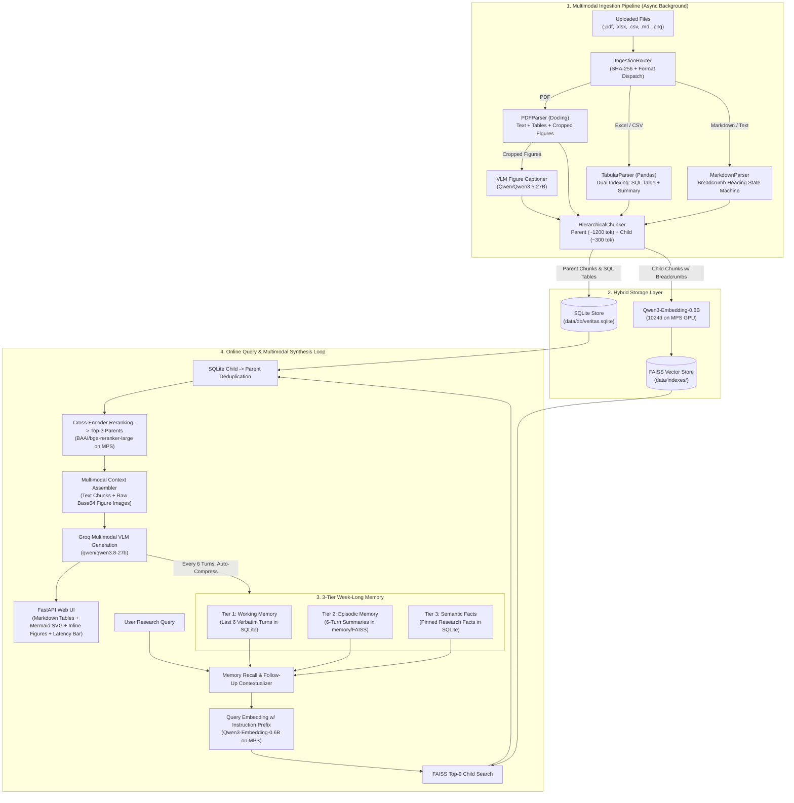

# VeritasAI — Multimodal Agentic Research Assistant (v1.0)

**VeritasAI (Research Mate)** is a lightweight, pure-Python multimodal Agentic RAG system built for deep, week-long research workflows across **PDF papers, Excel/CSV spreadsheets, Markdown docs, and technical figures/charts**.

> [!IMPORTANT]
> **Core Engineering Principles**
> - **Zero Framework Bloat**: Built in 100% idiomatic Python (`FastAPI`, `sqlite3`, `numpy`/`faiss`, `httpx`, `dataclasses`) — no LangChain, LlamaIndex, or LangGraph.
> - **Apple Silicon (`mps`) GPU Accelerated**: Local embedding (`Qwen/Qwen3-Embedding-0.6B`) and cross-encoder reranking (`BAAI/bge-reranker-large`) run directly on macOS Metal Performance Shaders (`device="mps"`) with offline local cache loading.
> - **True Multimodal RAG**: Extracts figures from PDFs, generates rich searchable captions at ingestion time (`Qwen/Qwen3.5-27B`), and passes the **raw figure images (Base64)** directly to the multimodal generation VLM (`qwen/qwen3.8-27b` on Groq) at query time.
> - **3-Tier Week-Long Memory**: Combines Working Memory (recent verbatim turns), Episodic Memory (auto-summarized conversation blocks indexed in FAISS), and Semantic Fact Memory (pinned research facts in SQLite).

---

## 1. System Architecture



---

## 2. Key Features (v1.0)

### 2.1 Multimodal Document Ingestion
| Modality | Parser | How It Works |
| :--- | :--- | :--- |
| **PDF Documents (`.pdf`)** | [`PDFParser`](ingestion/pdf_parser.py) (`docling`) | Preserves reading order and section headers, extracts tables into DataFrames, crops figures/charts to `data/uploads/figures/*.png`, and generates searchable visual descriptions via [`vlm_captioner.py`](ingestion/vlm_captioner.py). |
| **Spreadsheets (`.xlsx`, `.xls`, `.csv`)** | [`TabularParser`](ingestion/tabular_parser.py) (`pandas` + `openpyxl`) | **Dual Indexing**: <br>1. Writes sanitized sheets into SQLite tables (`t_<file>_<sheet>_<hash>`) for exact SQL execution.<br>2. Generates a rich schema + numeric stats (`min`, `max`, `mean`) + Markdown table summary indexed in FAISS. |
| **Markdown & Text (`.md`, `.txt`)** | [`MarkdownParser`](ingestion/markdown_parser.py) | Tracks `# H1 > ## H2 > ### H3` heading breadcrumbs via a state machine while keeping fenced code blocks (` ``` `) intact. |
| **Standalone Images (`.png`, `.jpg`, `.webp`)** | [`IngestionRouter`](ingestion/router.py) | Copies charts/diagrams to `data/uploads/figures/`, generates VLM descriptions, and links the image for visual retrieval. |

### 2.2 Hierarchical Parent-Child Chunking
- **Child Chunks (~300 tokens, 40-token overlap)**: Stored in FAISS with prepended contextual breadcrumbs:
  `[Doc: paper.pdf | Section: 3.2 Architecture | Page: 4] <chunk text>`
- **Parent Chunks (~1200 tokens)**: Stored unembedded in SQLite. When a Child Chunk matches in FAISS, its deduplicated Parent Chunk is retrieved so the reranker and LLM receive complete surrounding context.

### 2.3 Two-Stage Retrieval & Cross-Encoder Reranking on Apple Silicon GPU (`mps`)
1. **Stage 1 — Bi-Encoder Retrieval**: `Qwen/Qwen3-Embedding-0.6B` (1024-dimensional normalized vectors) encodes queries with an asymmetric retrieval instruction and searches `FAISSStore` (`IndexFlatIP` / exact inner-product fallback) for the Top-9 Child Chunks.
2. **Stage 2 — Cross-Encoder Reranking**: Expands child matches to unique Parent Chunks and scores `(query, parent_chunk)` pairs using `BAAI/bge-reranker-large` on `device="mps"` to select the Top-3 highest-relevance sections.

### 2.4 3-Tier Week-Long Conversation Memory
Managed by [`MemoryManager`](memory/memory_manager.py):
- **Tier 1 — Working Memory (`chat_turns`)**: Stores every user and assistant turn in SQLite and injects the last 6 verbatim turns into the active prompt. Also resolves short follow-up queries (*"What about its latency?"*) using recent turn context.
- **Tier 2 — Episodic Memory (`memory_episodes` + `data/indexes/memory/`)**: Every 6 turns, older turns are automatically summarized into a 2–3 sentence episode and embedded into a dedicated episodic FAISS index for semantic recall days later.
- **Tier 3 — Semantic Fact Memory (`semantic_facts`)**: Extracts and pins persistent research facts, definitions, and user preferences across the entire session.

### 2.5 End-to-End Step Latency Telemetry
Every query returns and displays a granular millisecond breakdown:
- `memory_recall_ms`: 3-tier SQLite + episodic FAISS recall
- `query_embedding_ms`: Qwen query encoding on MPS GPU
- `faiss_search_ms`: Vector similarity search
- `sqlite_lookup_ms`: Child-to-Parent chunk expansion
- `reranking_ms`: BGE-Large cross-encoder reranking on MPS GPU
- `llm_generation_ms`: Multimodal VLM answer synthesis on Groq
- `total_ms`: End-to-end wall-clock query latency

---

## 3. Repository Structure

```text
VeritasAI/
├── main.py                      # Entrypoint for CLI demo and FastAPI server (--serve)
├── requirements.txt             # Python dependencies
├── hld.md                       # High-Level Design specification
├── README.md                    # Project documentation (this file)
├── notes_ingestion.md           # Line-by-line code guide for ingestion/
├── notes_storage.md             # Line-by-line code guide for storage/
├── notes_memory.md              # Line-by-line code guide for memory/
├── notes_agent.md               # Line-by-line code guide for agent/
├── config/
│   ├── __init__.py
│   └── settings.py              # Centralized paths & model settings loaded from .env
├── ingestion/
│   ├── __init__.py
│   ├── models.py                # Dataclasses: ParentChunk, ChildChunk, ExtractedTable, IngestionResult
│   ├── chunker.py               # Hierarchical Parent-Child chunker with breadcrumb headers
│   ├── markdown_parser.py       # Header-aware Markdown parser
│   ├── tabular_parser.py        # Excel/CSV dual-indexing parser
│   ├── pdf_parser.py            # Docling PDF layout, table, and figure extractor
│   ├── vlm_captioner.py         # Qwen/Qwen3.5-27B VLM figure captioner
│   └── router.py                # SHA-256 hashing & file extension dispatcher
├── embeddings/
│   ├── __init__.py
│   ├── embedder.py              # Qwen/Qwen3-Embedding-0.6B on MPS GPU (offline cache enabled)
│   └── reranker.py              # BAAI/bge-reranker-large on MPS GPU (offline cache enabled)
├── storage/
│   ├── __init__.py
│   ├── sqlite_store.py          # SQLite storage for parent/child chunks & dynamic SQL tables
│   └── faiss_store.py           # FAISS IndexFlatIP vector store with NumPy fallback
├── memory/
│   ├── __init__.py
│   └── memory_manager.py        # 3-Tier Week-Long Memory (Working + Episodic FAISS + Semantic Facts)
├── agent/
│   ├── __init__.py
│   └── orchestrator.py          # Pure-Python RAG + Multimodal VLM + Memory orchestrator
├── api/
│   ├── __init__.py
│   └── app.py                   # FastAPI server & interactive Web UI (Marked.js + Mermaid.js)
├── tests/
│   ├── test_ingestion.py        # Unit tests for chunking, Markdown, and Excel/CSV parsing
│   └── test_agent_pipeline.py   # End-to-end tests for storage, embedder, reranker, and orchestrator
└── data/
    ├── uploads/                 # Uploaded PDFs, Excel sheets, Markdown files, and figures/
    ├── indexes/                 # Persisted FAISS vector indexes (documents + episodic memory)
    └── db/                      # SQLite database (veritas.sqlite)
```

---

## 4. Setup & Installation

### 4.1 Prerequisites
- **OS**: macOS (Apple Silicon M1/M2/M3/M4 recommended for `mps` GPU acceleration) or Linux
- **Python**: Python 3.11+ (tested on Python 3.13)
- **API Keys**:
  - `GROQ_API_KEY` (for multimodal generation with `qwen/qwen3.8-27b`)
  - `HUGGINGFACE_KEY` (optional, for ingestion-time VLM figure captioning with `Qwen/Qwen3.5-27B`)

### 4.2 Environment Setup
```bash
# 1. Enter repository directory
cd VeritasAI

# 2. Activate the virtual environment (or create one with: python3 -m venv venv)
source venv/bin/activate

# 3. Install dependencies
pip install -r requirements.txt
```

### 4.3 Configure `.env`
Create a `.env` file in the project root:
```env
GROQ_API_KEY=your_groq_api_key_here
HUGGINGFACE_KEY=your_huggingface_token_here
EMBEDDING_MODEL=Qwen/Qwen3-Embedding-0.6B
```

---

## 5. Running VeritasAI

### 5.1 Start the Interactive Web UI & API Server (Recommended)
```bash
venv/bin/python main.py --serve
```
Then open **http://localhost:8000** in your browser:
- **Multi-File Upload & Async Indexing**: Select multiple `.pdf`, `.xlsx`, `.csv`, `.md`, or image files and click **Ingest Documents**, or click **Sync `data/uploads/`** to index files placed directly in the uploads folder.
- **Live FAISS Status**: Watch real-time background embedding progress (`✅ Ready! X chunks indexed in FAISS`).
- **Rich Multimodal Chat**: Renders Markdown tables, code blocks, Mermaid flowcharts (`graph TD`), and extracted document figures (`/figures/...`) directly inside the chat window.
- **Session Memory Controls**: Switch sessions via the **Session** input box, view live memory counters (`🧠 Memory: X turns | Y facts | Z episodes`), or clear session memory at any time.

### 5.2 Run the CLI Pipeline Demo
To ingest all files in `data/uploads/` and run a test query in the terminal with a full latency printout:
```bash
venv/bin/python main.py
```

---

## 6. REST API Endpoints

FastAPI interactive Swagger documentation is available at **http://localhost:8000/docs**.

| Method | Endpoint | Description |
| :--- | :--- | :--- |
| `GET` | `/` | Serves the interactive VeritasAI Web UI |
| `GET` | `/status` | Returns background indexing progress and total vectors in FAISS |
| `POST` | `/ingest` | Uploads one or more documents, parses to SQLite, and embeds in background |
| `POST` | `/refresh_uploads` | Scans `data/uploads/` for unindexed files and captions/embeds them in background |
| `POST` | `/query` | Runs 3-tier memory recall + FAISS/BGE retrieval + multimodal VLM generation (`{query, session_id}`) |
| `GET` | `/memory` | Returns conversation turns, pinned semantic facts, and episodic memory count for `session_id` |
| `POST` | `/memory/clear` | Clears conversation memory for a specific `session_id` |
| `POST` | `/reset` | Wipes all SQLite chunks/tables, FAISS indexes, and conversation memory |
| `GET` | `/health` | Health check endpoint (`{"status": "ok"}`) |

---

## 7. Running Automated Tests

Run the unit and integration test suite via `pytest`:
```bash
venv/bin/pytest tests/ -v
```
