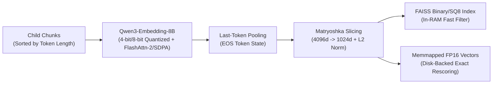
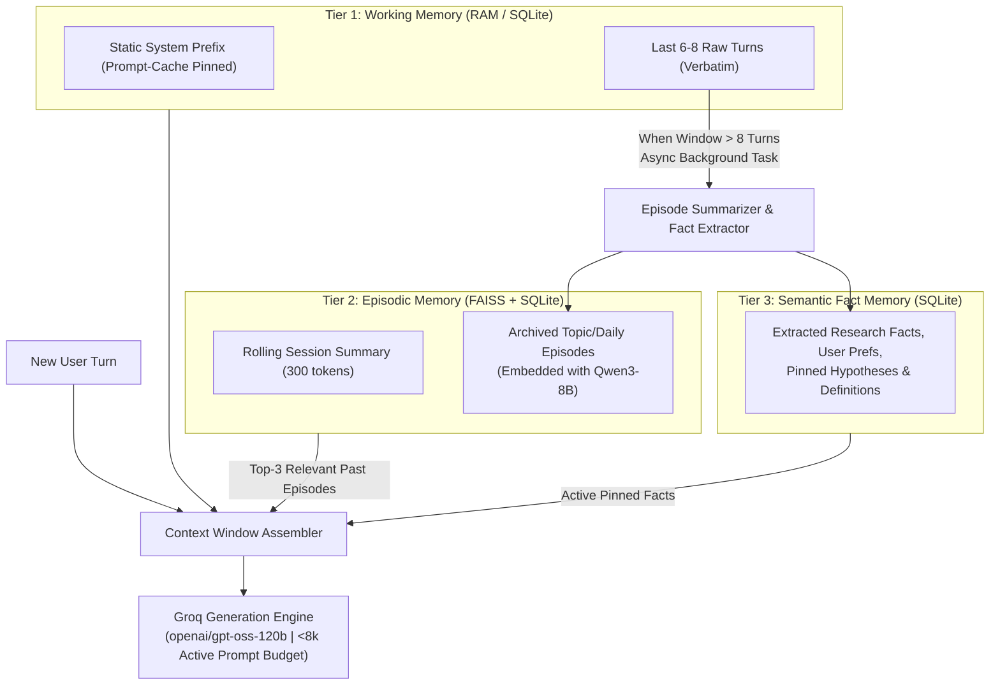
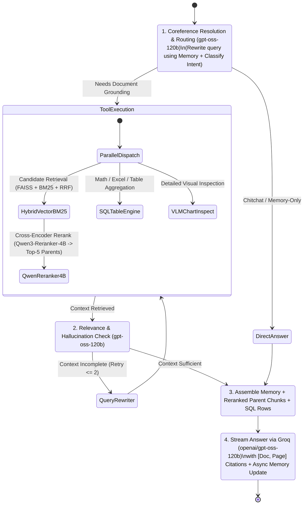

# High-Level Design (HLD): VeritasAI (Research Mate)

> [!IMPORTANT]
> **Core Design Philosophy**
> - **100% Open-Source & Zero Subscription Cost**: Local/self-hosted open-weight models, SQLite, DuckDB, and FAISS.
> - **Zero Orchestration Frameworks**: Pure, idiomatic Python (`asyncio`, dataclasses, state machines, FastAPI) — no LangChain, LlamaIndex, or LangGraph.
> - **Tri-Objective Optimization**: Every component is co-designed to minimize **Latency**, minimize **Compute/RAM Cost**, and maximize **Retrieval & Reasoning Accuracy**.

---

## 1. End-to-End System Architecture

The system is divided into four decoupled subsystems:
1. **Multimodal Ingestion & Parsing Pipeline** (Offline / Async Background)
2. **Hybrid Storage Layer** (FAISS + SQLite FTS5 + Structured Table Store)
3. **3-Tier Month-Long Memory Engine** (Working + Episodic + Semantic Memory)
4. **Pure-Python Agentic RAG Engine** (Online Query Loop via FastAPI)

### Diagram : https://excalidraw.com/#json=6xh6kboeueeStZ0bT3tQs,TOfnRRATn--LBhQuN3q3ow

## 2. Pillar 1: Multimodal Data Ingestion & Parsing

Standard RAG pipelines fail on research documents because flattening tables into text destroys numerical relationships, and ignoring charts loses critical findings. We use **Granite-Docling** (`ibm-granite/granite-docling-258M` via `docling`) alongside specialized Python processors.

### 2.1 Modality-Specific Processing Strategy

| Modality | Processing Engine | How It Is Indexed for High Accuracy |
| :--- | :--- | :--- |
| **PDFs (Text, Equations, Multi-column)** | **Granite-Docling** | Extracts reading order, section hierarchy, and LaTeX formulas into structured Docling Documents. |
| **PDF Tables & Excel (`.xlsx`, `.csv`)** | **Granite-Docling + Pandas / SQLite** | **Dual Indexing**:  1. *Discovery Chunk*: Table title, column schema, sample rows, and natural-language summary are embedded into FAISS. 2. *Execution Table*: Exact tabular data is written to SQLite/DuckDB so the Agent can run deterministic SQL (`SUM`, `AVG`, `GROUP BY`, filters) instead of hallucinating math. |
| **Graphs, Charts & Figures** | **Docling Figure Extractor + Local VLM** | Cropped figure bounding boxes are saved to disk. Granite-Docling / local VLM generates a **structured description + reconstructed markdown data table** of plotted values, indexed in FAISS with a pointer to the raw image path. |
| **Markdown (`.md`)** | **Pure Python AST / Regex Parser** | Preserves heading breadcrumb trees (`# H1 > ## H2 > ### H3`) and code/table blocks without breaking mid-block. |

### 2.2 Hierarchical Parent-Child Chunking with Contextual Headers
Instead of naive fixed-size chunking:
- **Parent Chunks (1024–2048 tokens)**: Stored in SQLite (unembedded). Represent full subsections or complete arguments.
- **Child Chunks (256–384 tokens)**: Embedded in FAISS. Every child chunk is prepended with its document breadcrumb header:
  `[Doc: paper.pdf | Section: 3.2 Ablation Study | Page: 7] <chunk text>`
- **Why this optimizes Accuracy & Latency**: Small child chunks produce sharp, noise-free embedding vectors for high retrieval precision, while returning the Parent Chunk gives the LLM full surrounding context without embedding redundant tokens.

---

## 3. Pillar 2: Optimal Embedding (`Qwen3-Embedding-8B`) & FAISS Architecture

`Qwen/Qwen3-Embedding-8B` is a top-performing MTEB model (4096 native dimensions, 32k context window, instruction-aware). Running an 8B model naively is slow and memory-heavy; we apply four stack optimizations:

### 3.1 `Qwen3-Embedding-8B` Inference Optimizations
1. **Matryoshka Representation Learning (MRL) Dimensionality Reduction**:
   - `Qwen3-Embedding-8B` is trained with Matryoshka loss, meaning the first $d$ dimensions carry the highest variance.
   - Slicing embeddings from `4096 -> 1024` (followed by L2 renormalization) reduces FAISS RAM usage and search latency by **4x** while retaining **~99% of full-dimension retrieval accuracy**.
2. **Asymmetric Instruction Prefixing**:
   - **Queries** use: `"Instruct: Given a research query, retrieve relevant passages, tables, or chart descriptions that answer the query\nQuery: {user_query}"`
   - **Documents** are encoded raw (no instruction prefix) and cached permanently.
3. **Quantization + Attention Acceleration**:
   - Run weights in **INT4 / INT8 (GGUF via `llama-cpp-python` or `bitsandbytes` / MLX on Mac)** to cut VRAM/RAM from ~16 GB (FP16) down to **~4.5–8 GB** with <0.5% MTEB drop.
   - Enable **FlashAttention-2** (CUDA) or **PyTorch SDPA** (Apple Silicon MPS).
4. **Length-Sorted Dynamic Batching**:
   - Sort chunks by token length before batching during ingestion so every batch pads only to the longest sequence in that micro-batch, cutting embedding time by **30–50%**.

### 3.2 Hybrid Search + Two-Stage FAISS Indexing
Pure vector search misses exact acronyms, part numbers, and variable names. We combine **FAISS** with **SQLite FTS5 (BM25)**:
1. **Stage 1A — Sparse Lexical Search**: SQLite FTS5 (`BM25`) retrieves Top-50 keyword matches in `<2 ms`.
2. **Stage 1B — Dense Vector Search (FAISS)**:
   - For `<100k` chunks: `faiss.IndexFlatIP(1024)` (exact inner product on normalized vectors).
   - For `>100k` chunks: **Binary Quantized FAISS (`IndexBinaryFlat` / `IndexBinaryIVF`)** + **2-Stage Rescoring**. Binary vectors take only `128 bytes` per chunk (32x compression), retrieves Top-200 via ultra-fast CPU XOR Hamming distance, and rescores those 200 against memory-mapped (`np.memmap`) FP16 vectors.
3. **Stage 2 — Reciprocal Rank Fusion (RRF) & Cross-Encoder Reranking (`Qwen3-Reranker-4B`)**:
   - Merge Dense + BM25 results via RRF to select the Top-20 candidate Child Chunks.
   - Rerank those Top-20 candidates down to the **Top-5** using **`Qwen/Qwen3-Reranker-4B`** (4-bit quantized for fast local M1 execution), which scores `(query, child_chunk)` pairs via cross-attention before expanding to deduplicated `ParentChunk`s in SQLite.

---

## 4. Pillar 3: Month-Long Chat Conversation Architecture

A month-long research conversation can easily exceed **500,000+ tokens** across hundreds of turns. Stuffing history into the prompt causes massive latency, high compute cost, and "lost-in-the-middle" reasoning degradation.

We solve this with a **3-Tier Cognitive Memory Architecture** backed by SQLite and a dedicated conversational FAISS index:

### How the 3 Tiers Work Together:
1. **Tier 1 — Working Memory (Prefix Cache Optimized)**:
   - Holds the last $K=6\text{ to }8$ turns verbatim.
   - **Latency trick**: Instead of sliding the window on *every* turn (which invalidates prefix prompt caching), we evict in **blocks of 4 turns** so the prefix remains 100% static for 4 consecutive turns, reducing Time-To-First-Token (TTFT) and input token overhead.
2. **Tier 2 — Episodic Memory (Long-Term Recall)**:
   - When 4 turns are evicted from Working Memory, a background async task compresses them into a timestamped **Episode Summary** and embeds it into a `memory.faiss` index.
   - If the user asks on Day 24: *"How does this compare to the baseline metric we discussed two weeks ago?"*, the agent queries `memory.faiss` and retrieves the exact Episode from Day 10.
3. **Tier 3 — Semantic Fact Store (Structured Research State)**:
   - A lightweight SQLite table storing persistent facts: `(entity, attribute, value, source_doc, updated_at)` — e.g., user's project goals, defined acronyms, or conclusions reached so far. Always injected compactly (~200–400 tokens) into the system prompt.

---

## 5. Pillar 4: Pure-Python Agentic RAG Loop (`groq/openai/gpt-oss-120b`)

Instead of bloated agent frameworks, the backend uses a ~150-line deterministic Python state machine (`AgentOrchestrator`) communicating directly with **Groq's LPU Inference Engine** running the open-weight **`openai/gpt-oss-120b`** model over pure async HTTP (`httpx`). Offloading the 120B generation model to Groq frees local unified memory exclusively for `Granite-Docling`, `Qwen3-Embedding-8B`, and `Qwen3-Reranker-4B`.

### Core Agentic Capabilities (Implemented in Plain Python):
- **Fast-Path Routing (Latency Saver)**: Simple follow-up questions that can be answered from Tier 1 Working Memory skip retrieval altogether (`0 retrieval latency`).
- **Sub-Query Decomposition (Parallel `asyncio.gather`)**: Complex comparative questions (*"Compare the revenue growth in Q3.xlsx with the projections in annual_report.pdf"*) are split into 2 independent sub-queries executed concurrently.
- **Cross-Encoder Precision Filtering (`Qwen3-Reranker-4B`)**: Filters RRF candidates using deep query-chunk interaction before fetching full parent chunks.
- **Deterministic Tabular Execution**: Any arithmetic, filtering, or sorting over Excel sheets or Docling-extracted PDF tables is routed to SQLite/DuckDB via generated SQL, preventing LLM calculation errors.
- **Self-Correction Loop (Bounded to Max 2 Retries)**: Before generating the final answer, a fast rubric checks if the retrieved chunks actually answer the query. If not, it rewrites the search terms or relaxes metadata filters.

---

## 6. Latency, Cost & Accuracy Optimization Summary

| Design Decision | Latency Impact | Cost / RAM Impact | Accuracy Impact |
| :--- | :--- | :--- | :--- |
| **Granite-Docling (`258M`)** | Fast local inference; avoids slow OCR pipelines | 100% Free; tiny 258M parameter footprint | Preserves complex PDF layouts, formulas, tables, and chart regions |
| **Dual Table Indexing (FAISS + SQLite SQL)** | SQL executes in `<5 ms` | Zero extra API cost | Eliminates LLM arithmetic & spreadsheet hallucinations |
| **`Qwen3-Embedding-8B` MRL (`1024d` + 4-bit)** | **4x faster** FAISS search; **2–3x faster** embedding | **4x smaller** index; **~4.5 GB RAM** instead of 16 GB | Retains ~99% of full 4096d MTEB leaderboard score |
| **FAISS Binary/SQ8 + FP16 Disk Rescore** | Sub-millisecond candidate filtering via CPU SIMD | **8x–32x less RAM** for vector index | Exact FP16 precision on top candidates |
| **Hybrid Search + `Qwen3-Reranker-4B`** | Reranks only Top-20 short child chunks (~300 tokens) | 4-bit quantized (~2.5 GB RAM); avoids reranking huge parent chunks | Cross-attention catches nuanced semantic relevance missed by bi-encoders |
| **Groq `openai/gpt-oss-120b` Generation** | Ultra-fast LPU streaming (~300–500+ tok/s) | Zero local RAM used for LLM; free/low-cost Groq API tier | Frontier 120B open-weight reasoning for complex multi-doc synthesis & SQL |
| **Block-Evicted 3-Tier Memory** | Preserves Prompt Prefix Cache (**60–80% faster TTFT**) | Caps active prompt to `<6k tokens` even at Day 30 | Prevents "lost-in-the-middle" degradation over month-long chats |

---

## 7. Proposed Tech Stack

| Layer | Technology | Why |
| :--- | :--- | :--- |
| **Language & API** | Python 3.13 + `FastAPI` + `uvicorn` | Async native, SSE streaming support, zero bloat |
| **Document Parsing** | `docling` (with `ibm-granite/granite-docling-258M`) + `openpyxl` | State-of-the-art layout, table, and figure extraction |
| **Embeddings** | `Qwen/Qwen3-Embedding-8B` (4-bit + MRL `1024d`) | Top MTEB accuracy with MRL & asymmetric instruction support |
| **Reranker** | `Qwen/Qwen3-Reranker-4B` (4-bit quantized) | High-precision cross-encoder reranking over RRF candidates |
| **Vector Database** | `faiss-cpu` | Battle-tested C++ vector engine with binary/scalar quantization |
| **Docstore, BM25 & Memory** | Python built-in `sqlite3` (with `FTS5`) | Single-file, serverless, ACID compliant, supports BM25 + SQL tables |
| **Generation & Reasoning LLM** | `openai/gpt-oss-120b` via **Groq API** (`httpx`) | Blazing-fast LPU inference for 120B open-weight model with zero local RAM overhead |
