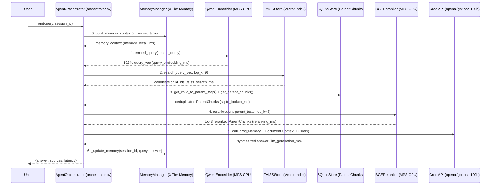

# Deep-Dive Code Notes: `agent` Module

This guide explains **every `.py` file, function, and line of code** inside the `agent/` package (`__init__.py` and `orchestrator.py`).

---

## Architectural Overview of `agent/`

---

## 1. `agent/__init__.py`

### Line-by-Line Explanation
- **Line 3**: `from agent.orchestrator import AgentOrchestrator` imports the orchestrator class.
- **Line 5**: `__all__ = ["AgentOrchestrator"]` exports `AgentOrchestrator` at the package level.

---

## 2. `agent/orchestrator.py`

### Purpose
Coordinates the entire online RAG + Memory pipeline in pure Python without LangChain or LangGraph:
1. Recalls 3-tier conversation memory and resolves short follow-up queries.
2. Embeds the query on Apple Silicon GPU (`mps`) and retrieves candidate child chunks from FAISS.
3. Expands child chunks to deduplicated full-context Parent Chunks from SQLite.
4. Reranks candidate Parent Chunks using the `BAAI/bge-reranker-large` cross-encoder on `mps`.
5. Calls Groq's `openai/gpt-oss-120b` model over HTTP (`httpx`) with both Conversation Memory and Document Context.
6. Updates conversation memory (and compresses older turns into episodes + facts every 6 turns) while logging millisecond latency for every stage.

---

### Line-by-Line Explanation

#### Imports & `__init__` (Lines 3–33)
- **Lines 3–10**: Imports `os`, `time` (`time.perf_counter()` for high-resolution latency measurement), `httpx` (HTTP client for Groq API), `Embedder`, `BGEReranker`, `MemoryManager`, `FAISSStore`, and `SQLiteStore`.
- **Lines 15–33 (`__init__`)**:
  - Stores references to `self.sqlite`, `self.faiss`, and `self.embedder`.
  - **Line 30**: `self.reranker = reranker or BGEReranker()` initializes the BGE cross-encoder reranker if one wasn't passed in.
  - **Line 31**: `self.memory = memory or MemoryManager(str(sqlite_store.db_path), embedder)` attaches the 3-tier `MemoryManager` using the same SQLite database and Qwen embedder.
  - **Line 32**: Defaults generation model to `"openai/gpt-oss-120b"`.
  - **Line 33**: Reads `GROQ_API_KEY` from the environment if `api_key` is not explicitly provided.

---

#### `retrieve_with_latency` (Lines 35–78)
Executes the 4-stage retrieval funnel and measures each step in milliseconds:
- **Line 37**: `timings: dict[str, float] = {}` initializes the latency dictionary.
- **Stage 1 — Query Embedding (Lines 39–42)**:
  - Records `t_start = time.perf_counter()`.
  - Calls `query_vec = self.embedder.embed_query(query)` (which prepends the retrieval instruction prefix and runs Qwen on MPS GPU).
  - Records elapsed milliseconds in `timings["query_embedding_ms"]`.
- **Stage 2 — FAISS Vector Search (Lines 44–47)**:
  - Searches `self.faiss.search(query_vec, top_k=top_k * 3)` (fetches $3 \times 3 = 9$ candidate child chunks so the cross-encoder reranker has a wider pool to pick the best 3 from).
  - Records `timings["faiss_search_ms"]`.
- **Empty Index Guard (Lines 49–52)**:
  - If FAISS returned no candidates (`not candidates`), sets `sqlite_lookup_ms = 0.0` and `reranking_ms = 0.0` and returns `([], timings)`.
- **Stage 3 — SQLite Child-to-Parent Expansion (Lines 54–60)**:
  - Extracts `child_ids = [cid for cid, _ in candidates]`.
  - Maps `child_id -> parent_id` via `self.sqlite.get_child_to_parent_map(child_ids)`.
  - Deduplicates parent IDs while preserving ranking order using `all_parent_ids = list(dict.fromkeys(id_map.values()))` (if 3 child chunks all matched inside the same parent section, we only fetch and rerank that parent section once).
  - Fetches the full `ParentChunk` objects from SQLite into `parents_by_id` and records `timings["sqlite_lookup_ms"]`.
- **Stage 4 — BGE Cross-Encoder Reranking (Lines 62–78)**:
  - Extracts the full text of each candidate parent chunk (`parent_texts`).
  - Calls `best_indices = self.reranker.rerank(query, parent_texts, top_k=top_k)` to score `(query, parent_text)` pairs jointly with `BAAI/bge-reranker-large` and select the top 3 indices.
  - Records `timings["reranking_ms"]`.
  - Formats the winning `ParentChunk`s into `sources` dicts (`{"doc", "section", "page", "content"}`) and returns `(sources, timings)`.

---

#### `call_groq` (Lines 80–108)
- **Lines 82–85**: Starts `t_start = time.perf_counter()`. If `self.api_key` is missing, returns a fallback string (`[No GROQ_API_KEY] ...`) so offline unit tests work without a live API key.
- **Lines 87–98**: Builds the OpenAI-compatible HTTP headers (`Authorization: Bearer ...`) and JSON payload (`model`, `messages` with `system` and `user` roles, and `temperature: 0.2` for factual grounded answers).
- **Lines 99–105**: Sends a synchronous `POST` request to `https://api.groq.com/openai/v1/chat/completions` with a 30-second timeout and calls `resp.raise_for_status()` to catch HTTP errors.
- **Lines 106–108**: Measures `latency_ms`, extracts `resp.json()["choices"][0]["message"]["content"]`, and returns `(answer, latency_ms)`.

---

#### `_update_memory` (Lines 110–137)
- **Lines 112–113**: Saves both the user's `query` and the assistant's `answer` into Tier 1 working memory (`chat_turns`).
- **Lines 115–116**: Checks how many uncompressed turns exist in the current session (`uncompressed = self.memory.get_uncompressed_turns(session_id)`).
- **Lines 117–137**: When `len(uncompressed) >= 6` (3 full user/assistant exchanges):
  - Takes the oldest 6 uncompressed turns (`to_compress = uncompressed[:6]`).
  - Formats their text and calls `self.call_groq` instructing the LLM to produce a 2–3 sentence episode summary followed by `FACTS:` with up to 2 key research facts or user preferences.
  - Splits the response on `"FACTS:"`:
    - Saves the episode summary to Tier 2 (`self.memory.save_episode(session_id, episode_summary)`), which writes to SQLite and embeds into `data/indexes/memory`.
    - Saves each bullet under `FACTS:` to Tier 3 (`self.memory.add_fact(session_id, cleaned)`).
  - Marks those 6 turns as `compressed = 1` via `self.memory.mark_turns_compressed(...)`.

---

#### `run` (Lines 139–209)
- **Line 141**: Records `t_total_start = time.perf_counter()`.
- **Step 0 — Memory Recall & Follow-Up Contextualization (Lines 143–152)**:
  - Calls `self.memory.build_memory_context(session_id, query)` to assemble Tier 3 facts, Tier 2 semantically recalled episodes, and Tier 1 recent turns.
  - If the current query is a short follow-up (`len(query.split()) < 10`, e.g., *"What about its KV cache?"*) and there is a previous user turn, prepends the previous user question to `search_query` so FAISS vector search has the topic entity name.
  - Records `memory_recall_ms`.
- **Steps 1–4 — Document Retrieval & Reranking (Lines 154–155)**:
  - Calls `self.retrieve_with_latency(search_query)` and attaches `timings["memory_recall_ms"]`.
- **Fallback Branch when No Document Chunks Exist (Lines 157–170)**:
  - Answers using conversation memory and general knowledge, updates memory, and returns the response dict.
- **Grounded Synthesis Branch (Lines 172–186)**:
  - Formats retrieved parent chunks with `[Doc: ... | Page: ...]` headers.
  - Constructs the system prompt instructing the model to use document context + conversation memory, cite `[Doc, Page]`, and preserve Markdown image links (``).
  - Combines `Conversation Memory:` and `Document Context:` with `Question: {query}` and calls `self.call_groq(prompt, system)`.
  - Calls `self._update_memory(session_id, query, answer)` and records `llm_generation_ms` and `total_ms`.
- **Console Latency Breakdown & Return (Lines 188–209)**:
  - Prints the formatted latency table (`Memory Recall`, `Query Embedding`, `FAISS Search`, `SQLite Parent Lookup`, `BGE Reranking`, `Groq LLM Generation`, and `Total Query Latency`) to the terminal and returns the JSON-ready response dict.
