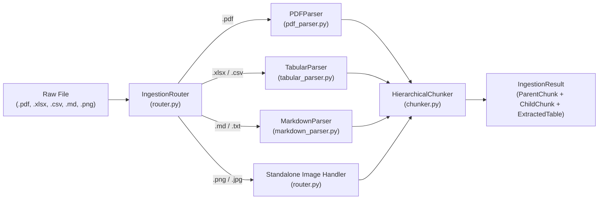

# Deep-Dive Code Notes: `ingestion` Module

This guide explains **every `.py` file, function, and line of code** inside the `ingestion/` package (`__init__.py`, `models.py`, `chunker.py`, `markdown_parser.py`, `tabular_parser.py`, `pdf_parser.py`, and `router.py`).

---

## Architectural Overview of `ingestion/`



---

## 1. `ingestion/__init__.py`

### Purpose
Exposes the public classes of the `ingestion` package so callers can import directly from `ingestion`.

### Line-by-Line Explanation
- **Line 1**: Module docstring describing the package.
- **Lines 3–8**:
  ```python
  from ingestion.chunker import HierarchicalChunker
  from ingestion.markdown_parser import MarkdownParser
  from ingestion.models import ChildChunk, ExtractedTable, IngestionResult, ParentChunk
  from ingestion.pdf_parser import PDFParser
  from ingestion.router import IngestionRouter
  from ingestion.tabular_parser import TabularParser
  ```
  Imports each core class from its respective submodule.
- **Lines 10–20**:
  ```python
  __all__ = [
      "ChildChunk",
      "ExtractedTable",
      "HierarchicalChunker",
      "IngestionResult",
      "IngestionRouter",
      "MarkdownParser",
      "PDFParser",
      "ParentChunk",
      "TabularParser",
  ]
  ```
  Defines `__all__`, which explicitly declares the public API exported when someone writes `from ingestion import *`.

---

## 2. `ingestion/models.py`

### Purpose
Defines the 4 pure-Python `@dataclass` structures used across the entire ingestion and storage pipeline:
1. `ExtractedTable` (structured spreadsheet/PDF table)
2. `ParentChunk` (~1200-token large context stored in SQLite)
3. `ChildChunk` (~300-token small retrieval unit with breadcrumb embedded in FAISS)
4. `IngestionResult` (container holding all outputs from parsing one document)

### Line-by-Line Explanation
- **Lines 3–4**:
  ```python
  from dataclasses import dataclass, field
  from typing import Any
  ```
  - `dataclass`: Decorator that auto-generates `__init__`, `__repr__`, and `__eq__`.
  - `field(default_factory=list)`: Safely initializes empty mutable lists per instance instead of sharing one default list across instances.

#### Class `ExtractedTable` (Lines 7–17)
- **Lines 7–9**: `@dataclass` definition for tables extracted from Excel, CSV, or PDFs.
- **Line 11 (`table_id: str`)**: Unique identifier for this table (e.g., `"tbl_doc_a1b2_0"`).
- **Line 12 (`doc_id: str`)**: Deterministic document ID based on the file's SHA-256 hash.
- **Line 13 (`sql_table_name: str`)**: Sanitized SQLite table name (e.g., `"t_llm_benchmarks_0"`) where the actual rows are stored for SQL queries.
- **Line 14 (`dataframe: Any`)**: The cleaned `pandas.DataFrame` holding the table rows and columns.
- **Line 15 (`schema_json: str`)**: JSON string mapping column names to their data types (e.g., `{"model": "object", "mmlu_score": "float64"}`).
- **Line 16 (`summary_text: str`)**: Natural-language + Markdown summary of the table (schema, min/max/mean stats, and sample rows) that gets chunked and embedded into FAISS so vector search can discover the table.
- **Line 17 (`page_number: int = 1`)**: Page number (for PDFs) or sheet number (for Excel), defaulting to `1`.

#### Class `ParentChunk` (Lines 20–29)
- **Lines 20–22**: `@dataclass` representing a large ~1200-token block of text stored **unembedded** in SQLite.
- **Line 24 (`parent_id: str`)**: Deterministic unique ID (`par_<doc_id>_<idx>_<sha1>`).
- **Line 25 (`doc_id: str`)**: ID of the source document.
- **Line 26 (`filename: str`)**: Human-readable file name (e.g., `"paper.pdf"`).
- **Line 27 (`section_path: str`)**: Heading hierarchy breadcrumb (e.g., `"1 Introduction > 1.1 Background"`).
- **Line 28 (`page_number: int`)**: Page number where the section appears.
- **Line 29 (`content: str`)**: Raw text of the parent section sent to the LLM during synthesis.

#### Class `ChildChunk` (Lines 32–42)
- **Lines 32–34**: `@dataclass` representing a small ~300-token retrieval unit that gets embedded into FAISS.
- **Line 36 (`child_id: str`)**: Deterministic unique ID (`chd_<parent_id>_<offset>_<sha1>`).
- **Line 37 (`parent_id: str`)**: Foreign key pointing to the `ParentChunk` this child came from.
- **Line 38 (`doc_id: str`)**: ID of the source document.
- **Line 39 (`breadcrumb_text: str`)**: The child text prefixed with `[Doc: ... | Section: ... | Page: ...]`, which is what the Qwen embedding model actually embeds.
- **Line 40 (`modality: str`)**: Indicates whether this chunk came from `"text"`, `"table_summary"`, or `"figure_caption"`.
- **Line 41 (`page_number: int = 1`)**: Page number in the source document.
- **Line 42 (`image_path: str | None = None`)**: Optional file path on disk if this chunk represents an extracted figure/chart image.

#### Class `IngestionResult` (Lines 45–85)
- **Lines 45–55**: Holds the complete result of parsing a file (`doc_id`, `filename`, `file_type`, `file_hash`, `parent_chunks`, `child_chunks`, `extracted_tables`).
- **Lines 57–85 (`to_dict(self)`)**:
  - **Line 59**: Imports `asdict` from `dataclasses` to recursively convert `ParentChunk` and `ChildChunk` dataclasses into Python dictionaries.
  - **Lines 61–70**: Builds top-level metadata and summary counts (`parent_chunks`, `child_chunks`, `extracted_tables`).
  - **Lines 71–72**: Converts every `ParentChunk` and `ChildChunk` to a dict.
  - **Lines 73–84**: Serializes each `ExtractedTable`, converting its `pandas.DataFrame` (`t.dataframe.fillna("").to_dict(orient="records")`) into a JSON-serializable list of row dicts (replacing `NaN` with `""`).

---

## 3. `ingestion/chunker.py`

### Purpose
Implements **Hierarchical Parent-Child Chunking with Contextual Breadcrumb Headers**.
- Splits a document section into large **Parent Chunks** (~1200 tokens) and then splits each Parent Chunk into smaller overlapping **Child Chunks** (~300 tokens with 40-token overlap).
- Prepends `[Doc: filename | Section: section_path | Page: page]` to every Child Chunk so embeddings never lose context.

### Line-by-Line Explanation
- **Lines 3–6**: Imports `hashlib` (for deterministic SHA-1 chunk IDs), `re` (for paragraph splitting), `settings` (default token sizes), and `ChildChunk`/`ParentChunk` models.

#### `__init__` (Lines 12–20)
- **Lines 12–17**: Accepts `parent_tokens` (default `1200`), `child_tokens` (default `300`), and `overlap_tokens` (default `40`).
- **Lines 18–20**:
  ```python
  self.parent_words = max(1, int(parent_tokens * 0.75))
  self.child_words = max(1, int(child_tokens * 0.75))
  self.overlap_words = max(0, int(overlap_tokens * 0.75))
  ```
  Converts token targets into word counts using the standard English ratio ($\approx 0.75\text{ words per token}$, or $1\text{ word} \approx 1.33\text{ tokens}$). `max(1, ...)` guarantees at least 1 word per chunk.

#### `format_breadcrumb` (Lines 22–26)
- **Line 25**: `section = section_path.strip() or "Root"` — defaults empty section paths to `"Root"`.
- **Line 26**: Returns `f"[Doc: {filename} | Section: {section} | Page: {page}] {text.strip()}"`. This ensures that even if a child chunk only says *"It achieves 88.5% accuracy"*, the embedded string carries the document name, section title, and page number.

#### `_make_id` (Lines 28–31)
- **Line 30**: `digest = hashlib.sha1(f"{doc_id}:{index}:{text[:120]}".encode("utf-8")).hexdigest()[:12]`
  Computes a 12-character SHA-1 hash from the `doc_id`, chunk `index`, and first 120 characters of text.
- **Line 31**: Returns `f"{prefix}_{doc_id[:8]}_{index}_{digest}"` (e.g., `par_doc_a1b2_0_9f8e7d6c5b4a`). Being deterministic means re-ingesting the same file produces the exact same IDs (`INSERT OR REPLACE` in SQLite won't duplicate rows).

#### `chunk_section` (Lines 33–81)
- **Lines 44–46**: Strips whitespace from `text`; if empty, returns `([], [])`.
- **Line 48**: `parent_texts = self._split_by_words(cleaned, self.parent_words, overlap=0)`
  Splits the section text into non-overlapping Parent chunks (`overlap=0`).
- **Lines 49–50**: Initializes empty `parents` and `children` lists.
- **Lines 52–64**: Loops over each `p_text` with `enumerate(parent_texts)`:
  - **Line 53**: `p_idx = start_index + p_offset` computes a unique index across sections.
  - **Line 54**: Generates deterministic `parent_id` with prefix `"par"`.
  - **Lines 55–64**: Appends a `ParentChunk` object containing the full un-prefixed `p_text`.
- **Line 66**: `child_texts = self._split_by_words(p_text, self.child_words, self.overlap_words)`
  Splits that specific `p_text` into smaller overlapping Child chunks.
- **Lines 67–79**: Loops over each `c_text`:
  - **Line 68**: Generates deterministic `child_id` linked to `parent_id`.
  - **Line 69**: Prepends the `[Doc | Section | Page]` breadcrumb header via `self.format_breadcrumb(...)`.
  - **Lines 70–79**: Appends the `ChildChunk` with `parent_id` linking back to its parent.
- **Line 81**: Returns `(parents, children)`.

#### `_split_by_words` (Lines 83–112)
- **Lines 86–88**: Splits `text` on whitespace; if total words $\le$ `max_words`, returns `[text.strip()]` immediately without splitting.
- **Line 90**: `blocks = [b.strip() for b in re.split(r"\n\s*\n", text) if b.strip()]`
  Splits text on blank lines (`\n\n`) so paragraphs stay together whenever possible instead of cutting mid-sentence.
- **Lines 91–92**: Initializes `chunks` (finished chunks) and `current_words` (words accumulating for the current chunk).
- **Lines 94–108**: Loops over each paragraph `block`:
  - **Line 95**: Splits the paragraph into `block_words`.
  - **Lines 96–97**: If adding `block_words` fits within `max_words`, appends them to `current_words`.
  - **Lines 98–101**: Otherwise, if `current_words` already has words, flushes `" ".join(current_words)` to `chunks`, and seeds the next `current_words` with the last `overlap` words (`current_words[-overlap:]`).
  - **Lines 102–107**: If a single giant paragraph itself exceeds `max_words`, slices `take = max_words - len(current_words)` words at a time in a `while` loop, flushing full chunks and retaining `overlap` words between slices.
  - **Line 108**: Appends the remaining `block_words` to `current_words`.
- **Lines 110–112**: Flushes any trailing `current_words` into `chunks` and returns `chunks`.

---

## 4. `ingestion/markdown_parser.py`

### Purpose
Parses Markdown (`.md`, `.markdown`, `.txt`) files by tracking the heading tree (`# H1 > ## H2 > ### H3`) as a state machine while ensuring `#` comments inside fenced code blocks (```` ```python ````) are **not** mistaken for Markdown headings.

### Line-by-Line Explanation
- **Line 8 (`HEADER_RE = re.compile(r"^(#{1,6})\s+(.+)$")`)**:
  Regex matching 1 to 6 `#` characters at the start of a line followed by whitespace and the heading title.
  - `group(1)`: The `#` characters (length tells us heading level 1–6).
  - `group(2)`: The heading text.
- **Line 9 (`FENCE_RE = re.compile(r"^(`{3,}|~{3,})")`)**:
  Regex matching code block fences (` ``` ` or `~~~`) at the start of a line.

#### `__init__` & `parse` (Lines 15–39)
- **Lines 15–16**: Stores `self.chunker` (creating a default `HierarchicalChunker()` if none is passed).
- **Line 20**: Reads the Markdown file as UTF-8 text (`errors="replace"` avoids crashing on stray invalid bytes).
- **Line 21**: Calls `self._extract_sections(raw_text)` to get a list of `(breadcrumb_path, section_body)` tuples.
- **Lines 26–38**: Loops over each `(breadcrumb, content)` section and calls `self.chunker.chunk_section(...)` with `start_index=idx * 100`, accumulating all `ParentChunk`s and `ChildChunk`s.

#### `_extract_sections` (Lines 41–77)
- **Line 44 (`headers: dict[int, str] = {}`)**: Maps active heading level (e.g., `1`, `2`, `3`) to its current title.
- **Line 45 (`sections: list[tuple[str, str]] = []`)**: Stores completed `(breadcrumb, body)` pairs.
- **Line 46 (`current_lines: list[str] = []`)**: Accumulates lines belonging to the current section.
- **Line 47 (`current_path = "Introduction"`)**: Default section name for text appearing before the first `#` heading.
- **Line 48 (`in_fence = False`)**: Boolean flag tracking whether the parser is currently inside a fenced code block (` ``` `).
- **Lines 50–73**: Iterates line-by-line:
  - **Lines 51–54**: If the line starts with ` ``` ` or `~~~`, toggles `in_fence = not in_fence`, appends the fence line to `current_lines`, and skips heading detection.
  - **Lines 56–70**: When `not in_fence`, checks `HEADER_RE.match(line)`:
    - **Lines 59–62**: If a heading is encountered, joins `current_lines` into `body`; if non-empty, saves `(current_path, body)` to `sections` and resets `current_lines = []`.
    - **Lines 64–66**: Records the new heading at `headers[level] = title`.
    - **Lines 67–68**: Deletes any deeper sub-headings (`k > level`) from `headers` (e.g., when a new `## H2` starts, any previous `### H3` under the old `H2` is cleared).
    - **Line 69**: Builds the new breadcrumb string (`" > ".join(headers[k] for k in sorted(headers))`, e.g., `"Architecture > Attention > Multi-Head"`).
  - **Line 72**: Regular text lines are appended to `current_lines`.
- **Lines 74–77**: Flushes the final section after the loop ends and returns `sections`.

---

## 5. `ingestion/tabular_parser.py`

### Purpose
Implements **Dual Indexing** for Excel (`.xlsx`, `.xls`) and CSV (`.csv`) files (and serves as a helper for PDF tables):
1. **Execution Table (`ExtractedTable`)**: Cleans the DataFrame and prepares it for exact SQL table creation in SQLite.
2. **Discovery Summary (`ParentChunk` + `ChildChunk`)**: Generates a text + Markdown summary containing column types, numeric statistics (`min`, `max`, `mean`), and a Markdown preview table so vector search in FAISS can retrieve the table.

### Line-by-Line Explanation
- **Lines 17–29 (`parse`)**:
  - Checks file extension (`suffix = file_path.suffix.lower()`).
  - If `.csv`, reads into a single-sheet dict `{file_path.stem: pd.read_csv(file_path)}`.
  - If `.xlsx` or `.xls`, calls `pd.read_excel(file_path, sheet_name=None, engine="openpyxl")`, where `sheet_name=None` loads **all sheets** in the workbook as a `dict[sheet_name, DataFrame]`.
- **Lines 35–74**: Loops over each `(sheet_name, df)`:
  - **Lines 36–38**: Calls `self._sanitize_dataframe(df)` to drop blank rows/columns and normalize column names; skips empty sheets.
  - **Line 40**: Creates `table_id = f"tbl_{doc_id[:8]}_{idx}"`.
  - **Line 41**: Creates a safe SQLite table name via `_make_sql_table_name(...)`.
  - **Line 42**: Builds `schema_dict` mapping each column name to its pandas dtype string.
  - **Lines 43–49**: Calls `_build_table_summary(...)` to generate the text/Markdown summary.
  - **Lines 51–61**: Appends the `ExtractedTable` object.
  - **Lines 63–73**: Chunks `summary_text` with `modality="table_summary"` into `ParentChunk`s and `ChildChunk`s.

#### `_sanitize_dataframe` (Lines 77–95)
- **Line 80**: `cleaned = df.dropna(how="all").dropna(axis=1, how="all").copy()`
  Drops rows that are 100% empty (`how="all"`) and columns that are 100% empty (`axis=1, how="all"`).
- **Lines 84–94**: Normalizes every column header into a valid lowercase SQL identifier:
  - `re.sub(r"\W+", "_", str(col).strip().lower()).strip("_")` replaces spaces/punctuation with underscores.
  - If a column name is empty or starts with a digit (`base[0].isdigit()`), prefixes it with `col_`.
  - Deduplicates repeated column names using `seen` counter (`col`, `col_1`, `col_2`).

#### `_make_sql_table_name` (Lines 97–101)
- Sanitizes the filename stem and sheet name to alphanumeric/underscore characters (up to 20 chars each) and combines them with `doc_id[:6]` and `idx` (e.g., `t_llm_benchmarks_compa_llm_benchmarks_a1b2c3_0`).

#### `_format_markdown_sample` (Lines 103–114)
- Formats the first `max_rows` of a DataFrame into standard GitHub-Flavored Markdown table syntax (`| col1 | col2 |\n| --- | --- |\n| val1 | val2 |`) using pure Python string joins.

#### `_build_table_summary` (Lines 116–147)
- **Lines 126–128**: Extracts `(rows, cols)` dimensions, column schema list, and Markdown table rows (`max_rows=20`).
- **Lines 130–138**: Selects numeric columns (`df.select_dtypes(include="number")`) and computes `min`, `max`, and `mean` for up to 8 numeric columns.
- **Lines 140–147**: Combines the table title, SQL table name, dimensions, schema, numeric stats, and Markdown rows into a single descriptive text block.

---

## 6. `ingestion/pdf_parser.py`

### Purpose
Uses **Docling** (`DocumentConverter`) to parse complex PDFs while preserving reading order, section headers, tables (exported to DataFrames), and figures/charts (cropped to PNG files on disk and linked as Markdown images).

### Line-by-Line Explanation
- **Lines 16–26 (`__init__`)**: Stores `HierarchicalChunker`, `TabularParser`, optional `figure_captioner` callback, and `figures_dir` (`data/uploads/figures`).

#### `parse` (Lines 28–115)
- **Lines 32–34**:
  ```python
  converter = self._create_converter()
  conv_result = converter.convert(str(file_path))
  doc = conv_result.document
  ```
  Initializes the Docling PDF converter and runs layout/table/figure extraction on `file_path`.
- **Lines 40–45**: Initializes state variables tracking `current_section` (`"Document Root"`), `current_page` (`1`), `text_buffer` (paragraphs accumulating under the current section), and counters for sections, tables, and figures.
- **Lines 47–64 (`flush_text_buffer`)**:
  Helper closure that joins accumulated `text_buffer` paragraphs with `"\n\n"`, clears the buffer, chunks the text via `self.chunker.chunk_section(...)`, and appends the resulting `ParentChunk`s and `ChildChunk`s.
- **Lines 66–107 (`for item, _level in doc.iterate_items():`)**:
  Walks every structural item in reading order:
  - **Lines 67–69**: Extracts the item's page number (`_get_item_page`) and label string (`section_header`, `title`, `table`, `picture`, `figure`, `chart`, or body text).
  - **Branch 1 — Section Headers (Lines 71–76)**: Flushes any buffered text from the previous section, updates `current_section = header_text`, and updates `current_page`.
  - **Branch 2 — Tables (Lines 78–88)**: Flushes buffered text and calls `_process_table_item(...)` to extract the table into both an `ExtractedTable` (for SQLite) and summary `ParentChunk`/`ChildChunk`s (for FAISS).
  - **Branch 3 — Figures / Charts / Pictures (Lines 90–98)**: Flushes buffered text and calls `_process_figure_item(...)` to crop the figure image to `data/uploads/figures/` and create a figure chunk with a Markdown image link (``).
  - **Branch 4 — Body Text (Lines 100–106)**: If the page number changed, flushes the buffer so page numbers stay accurate per chunk, then appends `item_text` to `text_buffer`.
- **Line 108**: Flushes any remaining text at the end of the document.
- **Lines 110–113**: Deletes `conv_result` and `converter` and triggers `gc.collect()` to free RAM on Apple Silicon.

#### `_create_converter` (Lines 116–137)
- Sets `SSL_CERT_FILE` via `certifi.where()` so macOS Python can verify HTTPS certificates if Docling downloads weights.
- Configures `PdfPipelineOptions`:
  - `do_ocr = settings.docling_do_ocr`
  - `do_table_structure = True` (enables table cell reconstruction)
  - `generate_picture_images = True` (crops figures into PIL images)
  - `images_scale = settings.docling_image_scale` (resolution multiplier for cropped figures)

#### `_get_item_page` (Lines 139–144)
- Reads `item.prov[0].page_no` (Docling's provenance metadata) to get the 1-based page number, falling back to `default`.

#### `_process_table_item` (Lines 146–195)
- Exports the Docling table item to a `pandas.DataFrame` (`item.export_to_dataframe(doc=doc)`), sanitizes it via `self.tabular._sanitize_dataframe`, builds the `ExtractedTable` and summary text via `self.tabular._build_table_summary`, and chunks it with `modality="table_summary"`.

#### `_process_figure_item` (Lines 197–244)
- **Lines 211–215**: Calls `item.get_image(doc)` to obtain the cropped `PIL.Image` and saves it to `data/uploads/figures/{doc_id[:8]}_p{page}_fig{idx}.png`.
- **Lines 217–223**: Extracts the figure caption from the PDF via `item.caption_text(doc)`.
- **Lines 224–226**: If a `figure_captioner` (VLM function) is configured, appends its visual description.
- **Lines 231–232**: Formats the chunk text with both the metadata tag and the Markdown image link `` so the web UI can render the image directly.
- **Lines 233–244**: Chunks the figure description with `modality="figure_caption"` and attaches `child.image_path`.

---

## 7. `ingestion/router.py`

### Purpose
Acts as the single entrypoint (`IngestionRouter.ingest_file(path)`) for all document types. Computes a deterministic SHA-256 hash of the file and dispatches it by file extension to `PDFParser`, `TabularParser`, `MarkdownParser`, or `_parse_standalone_image`.

### Line-by-Line Explanation
- **Lines 18–21**: Defines the sets of supported file extensions:
  - `TABULAR_EXTS = {".xlsx", ".xls", ".csv"}`
  - `MARKDOWN_EXTS = {".md", ".markdown", ".txt"}`
  - `PDF_EXTS = {".pdf"}`
  - `IMAGE_EXTS = {".png", ".jpg", ".jpeg", ".webp"}`
- **Lines 23–35 (`__init__`)**: Instantiates and wires together `HierarchicalChunker`, `MarkdownParser`, `TabularParser`, and `PDFParser`.
- **Lines 36–71 (`ingest_file`)**:
  - **Lines 38–40**: Resolves the file path and raises `FileNotFoundError` if it doesn't exist.
  - **Lines 42–43**: Computes the file's SHA-256 hash (`file_hash`) and sets `doc_id = f"doc_{file_hash[:16]}"`.
  - **Lines 46–61**: Dispatches to the matching parser based on `path.suffix.lower()`.
  - **Lines 63–71**: Wraps the outputs in an `IngestionResult` dataclass and returns it.
- **Lines 73–95 (`_parse_standalone_image`)**:
  - Copies standalone `.png`/`.jpg` uploads into `data/uploads/figures/{doc_id[:8]}_{path.name}` and creates a `figure_caption` chunk containing ``.
- **Lines 97–104 (`compute_sha256`)**:
  - Streams the file in 64 KB (`65536`-byte) binary chunks through `hashlib.sha256()` so even large files are hashed without loading the entire file into RAM at once.
