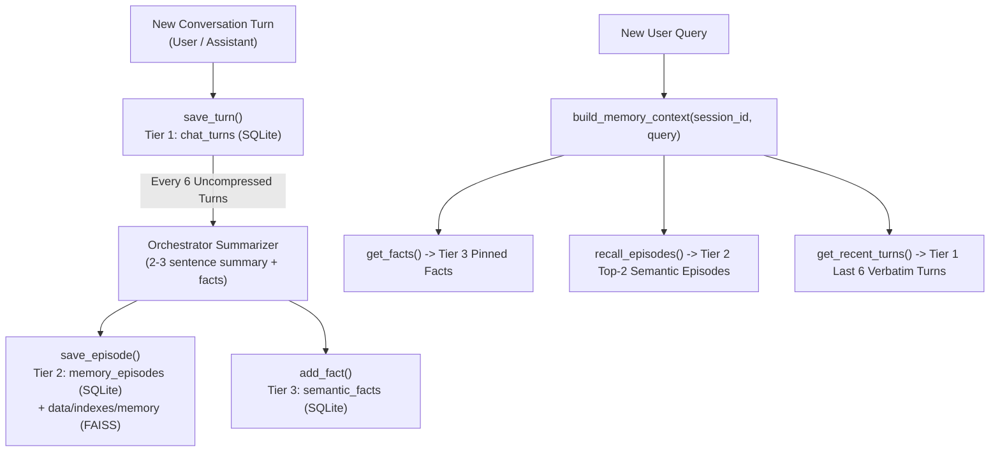

# Deep-Dive Code Notes: `memory` Module

This guide explains **every `.py` file, function, and line of code** inside the `memory/` package (`__init__.py` and `memory_manager.py`).

---

## Architectural Overview of `memory/` (3-Tier Week-Long Memory)

---

## 1. `memory/__init__.py`

- Empty package marker file allowing Python to import `memory.memory_manager`.

---

## 2. `memory/memory_manager.py`

### Purpose
Implements the **3-Tier Cognitive Memory Architecture** (Pillar 3 of the HLD) so multi-turn research conversations can continue for a full week without overflowing the LLM's context window or losing earlier findings:
1. **Tier 1 — Working Memory (`chat_turns` table in SQLite)**: Keeps the full log of messages and feeds the most recent $K=6$ turns verbatim into the prompt.
2. **Tier 2 — Episodic Memory (`memory_episodes` table in SQLite + `data/indexes/memory` FAISS store)**: Stores compressed summaries of older conversation blocks and embeds them in a dedicated FAISS vector store so the agent can semantically recall discussions from days earlier.
3. **Tier 3 — Semantic Fact Memory (`semantic_facts` table in SQLite)**: Stores persistent research conclusions, definitions, and user preferences that stay pinned across the entire session.

---

### Line-by-Line Explanation

#### Imports & `__init__` (Lines 3–24)
- **Lines 3–7**: Imports `sqlite3`, `time`, `Path`, `Embedder`, and `FAISSStore`.
- **Lines 13–24 (`__init__`)**:
  - **Line 15 (`db_path: str = "data/db/veritas.sqlite"`)**: Shares the main SQLite database file so all tables live in one place.
  - **Line 16 (`embedder: Embedder | None = None`)**: Reference to the Qwen `Embedder` instance used to embed and search Tier 2 episode summaries.
  - **Line 17 (`window_size: int = 6`)**: Number of recent verbatim turns (3 user + 3 assistant messages) kept in Tier 1 working memory.
  - **Lines 19–20**: Resolves `self.db_path` and ensures `data/db/` exists.
  - **Line 23**: `self.episode_faiss = FAISSStore(dim=1024, save_dir="data/indexes/memory")` creates a dedicated FAISS index in `data/indexes/memory/` separate from the document chunk FAISS index.
  - **Line 24**: Calls `self._init_tables()` to create the 3 memory tables in SQLite.

#### `_conn` (Lines 26–29)
- Opens a SQLite connection to `self.db_path` and sets `conn.row_factory = sqlite3.Row` for dict-like column access.

#### `_init_tables` (Lines 31–66)
- **Lines 34–45 (`chat_turns` — Tier 1)**:
  - `turn_id INTEGER PRIMARY KEY AUTOINCREMENT`: Auto-incrementing chronological turn ID.
  - `session_id TEXT`: Isolates different conversation threads/sessions.
  - `role TEXT`: `"user"` or `"assistant"`.
  - `content TEXT`: Full message text.
  - `compressed INTEGER DEFAULT 0`: Flag (`0` or `1`) tracking whether this turn has already been summarized into a Tier 2 episode.
  - `created_at REAL`: Unix timestamp (`time.time()`).
- **Lines 46–55 (`memory_episodes` — Tier 2)**:
  - `episode_id TEXT PRIMARY KEY`: Unique ID (matching the ID stored in `self.episode_faiss`).
  - `session_id TEXT`: Conversation session ID.
  - `summary TEXT`: 2–3 sentence summary of a block of 6 turns.
  - `created_at REAL`: Unix timestamp.
- **Lines 56–65 (`semantic_facts` — Tier 3)**:
  - `fact_id INTEGER PRIMARY KEY AUTOINCREMENT`: Auto-incrementing ID.
  - `session_id TEXT`: Conversation session ID.
  - `fact TEXT`: Extracted research fact, definition, or user preference.
  - `created_at REAL`: Unix timestamp.

#### Tier 1 Working Memory Methods (Lines 68–94)
- **`save_turn(self, session_id: str, role: str, content: str)` (Lines 68–75)**:
  Inserts a new `"user"` or `"assistant"` message with the current timestamp (`time.time()`) into `chat_turns`.
- **`get_recent_turns(self, session_id: str, limit: int | None = None)` (Lines 77–85)**:
  - Queries the latest `k` (`limit or self.window_size`) turns for `session_id` using `ORDER BY turn_id DESC LIMIT ?`.
  - Reverses the result (`reversed(rows)`) so the turns are returned in chronological order (oldest-to-newest of the last 6 turns).
- **`get_all_turns(self, session_id: str)` (Lines 87–94)**:
  Returns every turn in chronological order (`ORDER BY turn_id ASC`) so the web UI can restore the entire chat history when the page is opened or refreshed.

#### Tier 3 Semantic Fact Methods (Lines 96–114)
- **`add_fact(self, session_id: str, fact: str)` (Lines 96–104)**:
  Ignores blank strings and inserts a persistent fact into `semantic_facts`.
- **`get_facts(self, session_id: str, limit: int = 15)` (Lines 106–114)**:
  Fetches up to the 15 most recent pinned facts for `session_id` in chronological order.

#### Tier 2 Episodic Memory Methods (Lines 116–164)
- **`save_episode(self, session_id: str, summary: str)` (Lines 116–128)**:
  - **Line 118**: Generates a unique `episode_id = f"ep_{session_id}_{int(time.time() * 1000)}"`.
  - **Lines 119–124**: Saves `(episode_id, session_id, summary, time.time())` into `memory_episodes` in SQLite.
  - **Lines 125–127**: If `self.embedder` is available, embeds `[summary]` into a 1024d Qwen vector and indexes it into `self.episode_faiss`.
- **`recall_episodes(self, session_id: str, query: str, top_k: int = 2)` (Lines 130–145)**:
  - **Lines 132–133**: Returns `[]` if no embedder is attached or no episodes have been indexed yet.
  - **Lines 134–136**: Embeds the user's `query` and searches `self.episode_faiss` for the closest episode IDs.
  - **Lines 139–145**: Looks up the matching `summary` texts for `session_id` in `memory_episodes` and returns the top `top_k` summaries.
- **`get_uncompressed_turns` & `mark_turns_compressed` (Lines 147–163)**:
  - `get_uncompressed_turns`: Fetches all turns with `compressed = 0` for `session_id`.
  - `mark_turns_compressed`: Updates `SET compressed = 1` for turn IDs that have just been summarized into an episode so they are never summarized twice.

#### Context Assembly & Reset (`build_memory_context` & `clear`, Lines 165–195)
- **`build_memory_context(self, session_id: str, query: str)` (Lines 165–180)**:
  - Pulls **Pinned Research Facts** (Tier 3 via `get_facts`), **Relevant Past Session Summaries** (Tier 2 via `recall_episodes`), and **Recent Conversation History** (Tier 1 via `get_recent_turns`, capped at 400 chars per turn to keep the prompt compact).
  - Joins non-empty sections into a clean structured string ready to prepend to the LLM prompt.
- **`clear(self, session_id: str | None = None)` (Lines 182–195)**:
  - If `session_id` is specified, deletes turns, episodes, and facts only for that session.
  - If `session_id` is `None`, wipes all memory tables and clears `self.episode_faiss`.
