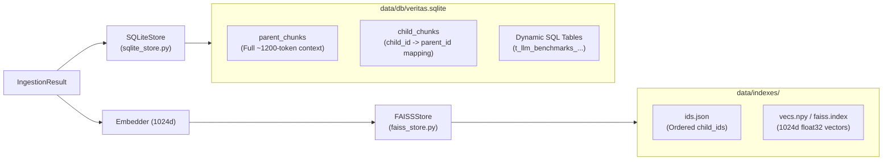

# Deep-Dive Code Notes: `storage` Module

This guide explains **every `.py` file, function, and line of code** inside the `storage/` package (`__init__.py`, `sqlite_store.py`, and `faiss_store.py`).

---

## Architectural Overview of `storage/`



---

## 1. `storage/__init__.py`

### Purpose
Re-exports `FAISSStore` and `SQLiteStore` at the package level.

### Line-by-Line Explanation
- **Lines 3–4**:
  ```python
  from storage.faiss_store import FAISSStore
  from storage.sqlite_store import SQLiteStore
  ```
  Imports the two storage classes from their respective files.
- **Line 6**: `__all__ = ["FAISSStore", "SQLiteStore"]` declares the public symbols of the `storage` package.

---

## 2. `storage/sqlite_store.py`

### Purpose
Manages all relational and document storage inside a single serverless SQLite file (`data/db/veritas.sqlite`):
1. `parent_chunks`: Stores unembedded ~1200-token Parent Chunks for full-context LLM synthesis.
2. `child_chunks`: Maps each ~300-token `child_id` (stored in FAISS) back to its `parent_id`.
3. **Dynamic SQL Tables**: Writes `pandas.DataFrame`s extracted from Excel/CSV/PDF tables into real SQLite tables so SQL queries can run against them.

### Line-by-Line Explanation
- **Lines 3–5**:
  ```python
  from pathlib import Path
  import sqlite3
  from ingestion.models import ChildChunk, ExtractedTable, ParentChunk
  ```
  Imports `Path` for filesystem paths, Python's built-in `sqlite3` engine, and the data models from `ingestion.models`.

#### `__init__` (Lines 11–14)
- **Line 11**: `def __init__(self, db_path: str = "data/db/veritas.sqlite") -> None:`
  Defaults the database file path to `data/db/veritas.sqlite`.
- **Line 12**: `self.db_path = Path(db_path)` converts the string path into a `Path` object.
- **Line 13**: `self.db_path.parent.mkdir(parents=True, exist_ok=True)` ensures the parent directory (`data/db/`) exists before SQLite tries to open the file.
- **Line 14**: `self._init_db()` creates the required tables if they do not exist yet.

#### `_get_connection` (Lines 16–19)
- **Line 17**: `conn = sqlite3.connect(self.db_path)` opens a connection to the SQLite database file on disk.
- **Line 18**: `conn.row_factory = sqlite3.Row` configures SQLite rows to behave like dictionaries (allowing column access by name such as `row["parent_id"]` instead of numeric tuple indices `row[0]`).
- **Line 19**: Returns the configured `sqlite3.Connection`.

#### `_init_db` (Lines 21–46)
- **Line 23**: `with self._get_connection() as conn:` opens a connection context manager.
- **Lines 24–35**: Executes `CREATE TABLE IF NOT EXISTS parent_chunks (...)`:
  - `parent_id TEXT PRIMARY KEY`: Unique identifier for the parent chunk.
  - `doc_id TEXT`: Document hash identifier.
  - `filename TEXT`: Source file name (e.g., `"paper.pdf"`).
  - `section_path TEXT`: Section breadcrumb (e.g., `"Methodology > Attention"`).
  - `page_number INTEGER`: Page or sheet number.
  - `content TEXT`: Full text of the parent chunk.
- **Lines 36–45**: Executes `CREATE TABLE IF NOT EXISTS child_chunks (...)`:
  - `child_id TEXT PRIMARY KEY`: Unique ID matching the vector entry in FAISS.
  - `parent_id TEXT`: ID of the parent chunk this child belongs to.
  - `doc_id TEXT`: Document hash identifier.
  - `breadcrumb_text TEXT`: Child chunk text prefixed with `[Doc | Section | Page]`.
- **Line 46**: `conn.commit()` flushes the schema creation to disk.

#### `save` (Lines 48–75)
- **Lines 48–53**: Accepts lists of `ParentChunk`s, `ChildChunk`s, and optional `ExtractedTable`s.
- **Lines 56–60**: Loops over `parents` and runs:
  ```python
  conn.execute(
      "INSERT OR REPLACE INTO parent_chunks VALUES (?, ?, ?, ?, ?, ?)",
      (p.parent_id, p.doc_id, p.filename, p.section_path, p.page_number, p.content),
  )
  ```
  - `?` placeholders prevent SQL injection and properly escape quotes/special characters in document text.
  - `INSERT OR REPLACE` makes ingestion idempotent (re-uploading the same file overwrites existing chunk IDs cleanly without throwing a `UNIQUE constraint failed` error).
- **Lines 61–65**: Loops over `children` and inserts `(c.child_id, c.parent_id, c.doc_id, c.breadcrumb_text)` into `child_chunks`.
- **Lines 66–73**: If `tables` are provided, loops over each `ExtractedTable`:
  - Checks `t.dataframe is not None and not t.dataframe.empty`.
  - Calls `t.dataframe.to_sql(t.sql_table_name, conn, if_exists="replace", index=False)`, which uses `pandas` to create a real SQLite table named `t.sql_table_name` and bulk-insert all DataFrame rows.
- **Line 74**: `conn.commit()` commits the transaction atomically to disk.

#### `get_parent_chunks` (Lines 76–94)
- **Lines 78–79**: If `parent_ids` is empty, returns `[]` immediately without querying SQLite.
- **Line 80**: `placeholders = ",".join("?" for _ in parent_ids)` dynamically generates `"?,?,?"` matching the number of requested IDs.
- **Lines 81–84**: Queries `SELECT * FROM parent_chunks WHERE parent_id IN (...)` and fetches all matching rows.
- **Lines 85–94**: Reconstructs and returns a list of `ParentChunk` dataclass instances from the SQLite rows.

#### `get_child_to_parent_map` (Lines 96–107)
- **Lines 98–99**: Returns `{}` if `child_ids` is empty.
- **Lines 100–106**: Queries `SELECT child_id, parent_id FROM child_chunks WHERE child_id IN (...)`.
- **Line 107**: Returns a dictionary `{r["child_id"]: r["parent_id"]}` mapping each retrieved child chunk ID to its parent chunk ID.

#### `execute_sql` (Lines 109–114)
- Executes a SQL query string against the SQLite database (used for querying extracted Excel/PDF tables) and converts each `sqlite3.Row` into a standard Python `dict`.

#### `clear` (Lines 116–121)
- Deletes all rows from `parent_chunks` and `child_chunks` and commits, resetting the document store.

---

## 3. `storage/faiss_store.py`

### Purpose
Stores 1024-dimensional L2-normalized embedding vectors and maps them to `child_id` strings.
- Uses `faiss.IndexFlatIP` (exact inner-product / cosine similarity) if `faiss` is installed, and automatically falls back to an **exact NumPy matrix dot-product** (`np.dot(self.vectors, q_vec.T)`) if `faiss` is not installed.
- Persists both `ids.json` and `vecs.npy` / `faiss.index` to disk (`data/indexes/`).

### Line-by-Line Explanation
- **Lines 7–10**:
  ```python
  try:
      import faiss
  except ImportError:
      faiss = None
  ```
  Attempts to import `faiss`; if unavailable on the host Python build, sets `faiss = None` so the NumPy fallback handles search seamlessly.

#### `__init__` (Lines 16–27)
- **Line 16**: `def __init__(self, dim: int = 1024, save_dir: str = "data/indexes") -> None:`
  Defaults to `dim=1024` (matching `Qwen/Qwen3-Embedding-0.6B`) and directory `data/indexes`.
- **Lines 18–22**: Creates `save_dir` and defines paths for `faiss.index`, `ids.json`, and `vecs.npy`.
- **Line 24**: `self.ids: list[str] = []` holds the ordered list of `child_id`s corresponding to each vector row.
- **Line 25**: `self.vectors = np.empty((0, self.dim), dtype=np.float32)` initializes an empty 2D float32 array of shape `(0, 1024)`.
- **Line 26**: Creates `faiss.IndexFlatIP(self.dim)` if `faiss` is present, else `None`.
- **Line 27**: Calls `self.load()` to restore any previously saved vectors and IDs from disk on startup.

#### `add` (Lines 29–38)
- **Lines 31–32**: If `chunk_ids` is empty, returns immediately.
- **Line 33**: Converts input `vectors` to a `np.float32` NumPy array `vecs` of shape `(N, dim)`.
- **Lines 34–35**: If `self.index` is active, adds `vecs` to the FAISS index.
- **Line 36**: `self.vectors = np.vstack([self.vectors, vecs])` appends the new vectors vertically to the in-memory matrix.
- **Line 37**: `self.ids.extend(chunk_ids)` appends the matching `child_id`s in the exact same order.
- **Line 38**: Calls `self.save()` to persist the updated index to disk.

#### `search` (Lines 40–56)
- **Lines 42–43**: Returns `[]` if no vectors have been indexed yet (`len(self.ids) == 0`).
- **Line 44**: Reshapes `query_vector` into a 2D float32 array of shape `(1, dim)`.
- **Line 45**: `top_k = min(top_k, len(self.ids))` ensures we never ask for more results than total indexed vectors.
- **Lines 47–49 (FAISS branch)**: Runs `self.index.search(q_vec, top_k)` and maps each returned integer row index `idx` back to `(self.ids[idx], float(score))`.
- **Lines 51–56 (NumPy fallback branch)**:
  - **Line 52**: `scores = np.dot(self.vectors, q_vec.T).squeeze()` computes the exact inner product between all stored vectors `(M, dim)` and the query vector `(dim, 1)`. Since Qwen embeddings are L2-normalized (`normalize_embeddings=True`), inner product equals exact cosine similarity!
  - **Lines 53–54**: Handles the edge case where only 1 vector is in the store (`scores.ndim == 0`).
  - **Line 55**: `best_indices = np.argsort(scores)[::-1][:top_k]` sorts vector indices from highest similarity score to lowest and slices the top `top_k`.
  - **Line 56**: Returns `[(self.ids[i], float(scores[i])) for i in best_indices]`.

#### `save`, `load`, and `clear` (Lines 58–83)
- **`save` (Lines 58–64)**: Writes `self.ids` to `ids.json` and saves either `faiss.index` or `vecs.npy` to disk.
- **`load` (Lines 66–73)**: Reads `ids.json` and loads `faiss.index` or `vecs.npy` into memory if the files exist on disk.
- **`clear` (Lines 75–83)**: Resets `self.ids = []` and `self.vectors` in memory and deletes `ids.json`, `vecs.npy`, and `faiss.index` from disk.
